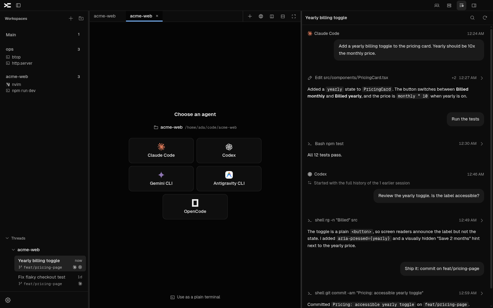
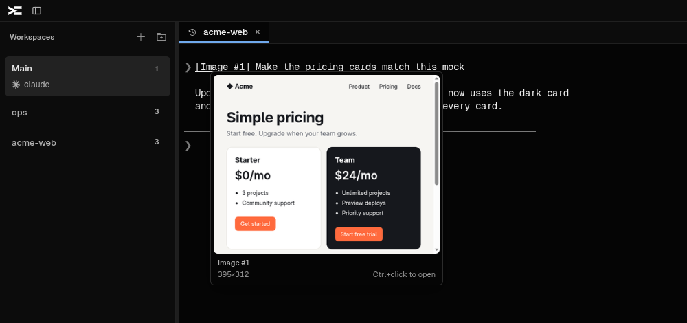
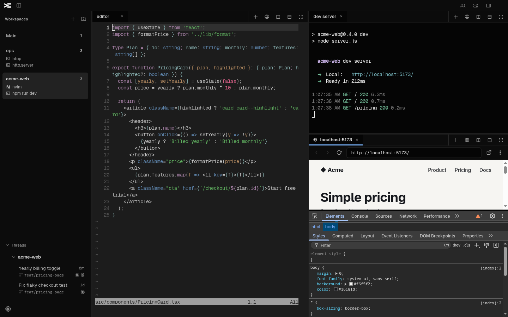
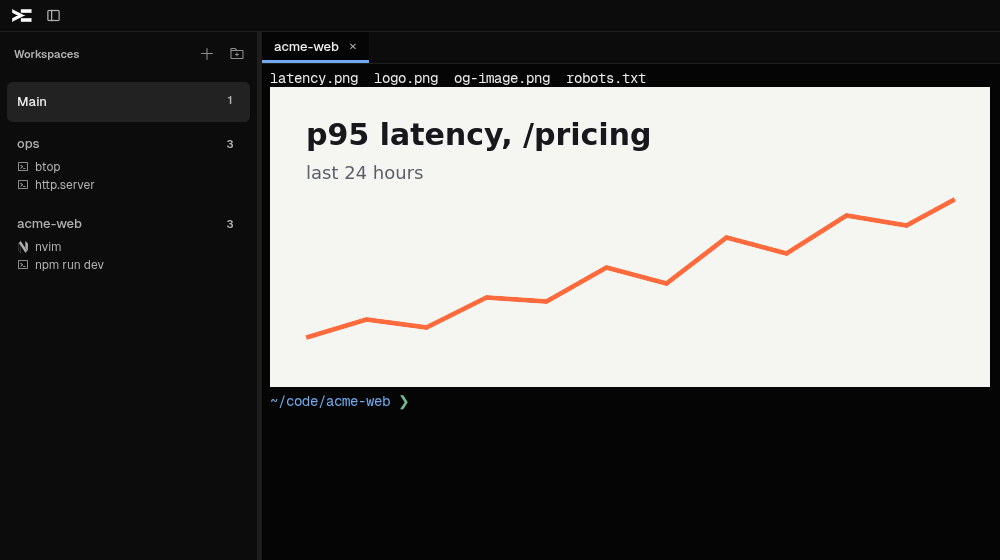
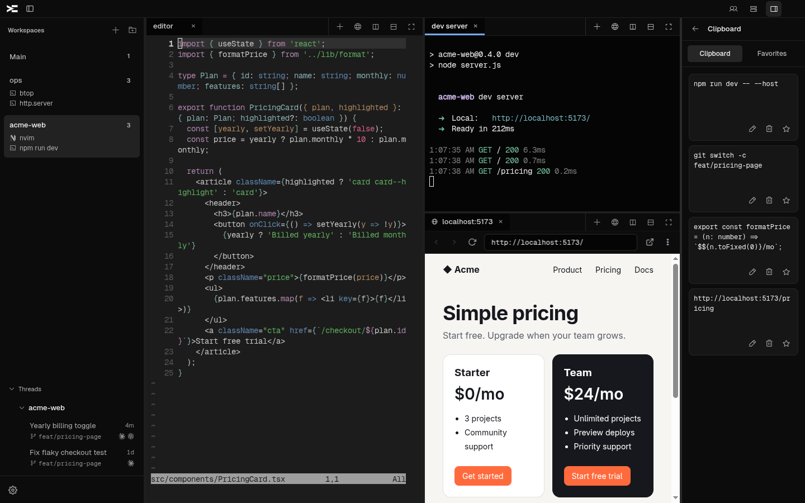

<p align="center">
  
</p>

<h1 align="center">TerminalVibe</h1>

<p align="center">
  A terminal multiplexer for the AI-agent era.<br>
  Workspaces, split panes, agent threads and real browser tabs in one quiet, keyboard-first desktop app.
</p>

<p align="center">
  <a href="https://github.com/Medamine-Bahassou/TerminalVibe/releases">Download</a> ·
  <a href="#features">Features</a> ·
  <a href="#keyboard-shortcuts">Shortcuts</a> ·
  <a href="#development">Development</a> ·
  <a href="ARCHITECTURE.md">Architecture</a>
</p>

<p align="center">
  
</p>

## Why TerminalVibe

Your editor, dev server, logs, coding agents and the page you're building all live
in one window. Each project gets its own **workspace** with its own split layout, and
each piece of agent work gets its own **thread** with its full history. The sidebar
shows what is running everywhere, so you can see which workspaces are busy without
opening them.

## Features

- [Workspaces and layout](#workspaces-and-layout)
- [Threads: agent work per project](#threads-agent-work-per-project)
- [Built for coding agents](#built-for-coding-agents)
- [Built-in browser](#built-in-browser)
- [Terminal](#terminal)
- [Command palette, tab search and snippets](#command-palette-tab-search-and-snippets)
- [Clipboard history and auto-run](#clipboard-history-and-auto-run)
- [Look and feel](#look-and-feel)
- [Profiles](#profiles)
- [Extensible](#extensible)

### Workspaces and layout

- **Workspaces** with names, icons, colors and folders. Drag to reorder, pin the ones you use most, and jump with `Alt+1` … `Alt+9`. Your last workspace is restored on launch.
- **Recursive split panes**, horizontal and vertical. Drag tabs between panes, or onto the sidebar to move them to another workspace.
- **Tab groups** in every pane. Each group holds any mix of terminals and browser tabs. Close other tabs, tabs to the right or all tabs from the tab menu.
- **Maximize** any tab (`Ctrl+Shift+M`), **lock** a tab to block accidental typing, or **detach** a tab into its own window and attach it back later.
- **Live process list** for every workspace in the sidebar, with brand icons for `nvim`, `node`, `python`, `claude`, `codex` and more.
- **Sidebar modes**: always visible, expand on hover, or hidden behind a toggle (`Ctrl+Shift+S`).

<p align="center"></p>

### Threads: agent work per project

A **thread** is one piece of agent work in a project folder. Threads are listed under their project in the sidebar, newest first, with the last activity time, the git branch and a logo for each agent used.

- **Pick an agent to start**: a new thread opens on cards for every agent CLI found on your `PATH` (Claude Code, Codex, Gemini CLI, Antigravity, OpenCode, Cursor Agent, Copilot CLI, Amp, Qwen Code, Aider), or a plain terminal.
- **New tab = new agent**: in a running thread, a new tab opens on the same cards, so you can bring in another agent next to the first.
- **Hand off between agents**: when a new agent joins, it gets the whole conversation so far as a handoff file, so Codex can pick up where Claude Code stopped.
- **History panel**: your prompts, the replies, tool calls (expand one to see the full command) and pasted images, read from Claude Code and Codex transcripts. Find in the history with `Ctrl+F` and copy any message.
- **Fork** a thread from any message into a new thread that any agent can continue.
- **No project? No problem**: a thread without a project gets its own scratch folder under `~/.terminalvibe/scratch/`.

TerminalVibe keeps its own copy of each thread's history, so it survives deleted transcripts. See [docs/projects.md](docs/projects.md).

<p align="center"></p>

### Built for coding agents

- **Claude Code session history**: a drawer in any Claude tab that lists past conversations across projects. Search them, resume one in place, open one in a new tab, or drag one into a chat to attach its context.
- **Workspace context**: drag a workspace onto a Claude chat to attach a snapshot of all its tabs.
- **Image previews on hover**: Claude Code and Codex only show a pasted image as an `[Image #N]` chip. Hover the chip to see the image itself, in your draft or in any message you already sent. Long pastes (`[Pasted text #N +M lines]`) and image paths in any terminal preview the same way. `Ctrl+click` opens the full viewer with zoom, pan and rotate.
- **Agent orchestration skill**: install it for Claude Code or Codex from **Settings → Skills**. Your agent can then open other agents in named splits, arrange panes, read their output, send follow-up input, and drive browser panes through an authenticated local control channel. See [docs/agent-orchestration.md](docs/agent-orchestration.md).
- **Finished notifications** with an optional chime when a command, Claude Code or Codex finishes in a tab you're not looking at.

<p align="center"></p>

<p align="center">
  
  
</p>

### Built-in browser

- **Browser tabs next to your terminals**, with back/forward, reload, URL bar search (Google or your own engine) and browsing history.
- **DevTools drawer** (`F12`) docked under the page, resizable, per tab.
- **Running servers** menu in the titlebar lists every listening port with its process. Click one to open it in a tab.
- Opens local files, **PDFs** and **images** in the browser's native viewers.
- Terminal links open with `Ctrl+click`, in a browser tab or your system browser (your choice in Settings; `Ctrl+Shift+click` uses the other one).

<p align="center"></p>

<p align="center"></p>

### Terminal

- xterm.js with the WebGL renderer, Unicode 11 and clickable links.
- **Inline images**: SIXEL and iTerm2 protocols, including Yazi previews.
- **Hide email addresses**: emails in terminal output are blurred until you click one. Turn it off in **Settings → Terminal**.
- **Drop files or text** into a terminal to paste their paths or contents.
- **Shell integration** for bash and zsh: the working directory (OSC 7) and prompt markers are tracked and persisted.
- **Default shell** setting, plus a shell picker on the new-tab button (right-click). WSL tabs keep their folder.
- Incremental search (`Ctrl+Shift+F`), per-terminal font zoom (`Ctrl+Scroll`), multi-select (`Ctrl+Alt+Click`) and pasting images.
- **Directional pane focus** with `Alt+H/J/K/L`.
- **Flow control**: a program that floods output is paused until the terminal catches up, so the UI stays responsive.

<p align="center"></p>

### Command palette, tab search and snippets

- **Command palette** (`Ctrl+Shift+K`): every action, workspace and thread in one searchable list, with shortcuts shown.
- **Tab search** (`Ctrl+Shift+O`): jump to any tab in any workspace.
- **Snippets** (`Ctrl+Shift+Y`) and **browser history** in the same palette.
- Tooltips show the keyboard shortcut for each button.

<p align="center">
  
  
</p>

### Clipboard history and auto-run

The right panel (titlebar button) holds two tools:

- **Clipboard history**: everything you copy, with favorites, edit and delete. Click an entry to paste it.
- **Auto-run workspaces**: save a layout once, then launch it again with every tab running its command or opening its URL.

<p align="center"></p>

### Look and feel

- Calm dark UI with Geist Sans and Geist Mono, and dark, light or system color schemes.
- **9 built-in themes**: Carbon, Graphite, Catppuccin Mocha, Dracula, Gruvbox, Tokyo Night, Nord, Solarized Dark and Monochrome. Import custom themes as JSON.
- Terminal **background images**: global, per workspace or per tab, with adjustable opacity.
- **Every shortcut can be rebound** in Settings, with conflict detection and per-shortcut reset.
- Fonts, icons and styles ship with the app, so it makes no network requests at launch.

<p align="center">
  
  
</p>

### Profiles

Fully isolated sets of workspaces, threads and settings, with a launch picker and a default profile (`Ctrl+Shift+P`).

<p align="center"></p>

### Extensible

- **Plugins**: drop a folder into `~/.terminalvibe/plugins/` to add commands, keybindings, terminal hooks, context-menu items, themes, settings sections and widgets. See [docs/plugin-development.md](docs/plugin-development.md).
- **CLI**: `terminalvibe new | create -f layout.yaml | list | close | attach` builds workspaces from the command line or from YAML. See [docs/cli.md](docs/cli.md).

## Keyboard shortcuts

These are the defaults. Rebind any of them in **Settings → Shortcuts**.

| Action | Shortcut |
|---|---|
| New terminal / close tab | `Ctrl+Shift+T` / `Ctrl+Shift+W` |
| New browser tab | `Ctrl+Shift+B` |
| Split horizontal / vertical | `Ctrl+Shift+D` / `Ctrl+Shift+E` |
| Command palette | `Ctrl+Shift+K` |
| Search tabs | `Ctrl+Shift+O` |
| Snippets | `Ctrl+Shift+Y` |
| Search in terminal (or in the thread history) | `Ctrl+Shift+F` (`Ctrl+F` in the history panel) |
| Copy / paste | `Ctrl+Shift+C` / `Ctrl+Shift+V` |
| Next / previous tab | `Ctrl+PageDown` / `Ctrl+PageUp` |
| Next / previous workspace | `Ctrl+Shift+PageDown` / `Ctrl+Shift+PageUp` |
| Jump to workspace 1–9 | `Alt+1` … `Alt+9` |
| Focus pane left / down / up / right | `Alt+H` / `Alt+J` / `Alt+K` / `Alt+L` |
| Maximize / restore tab | `Ctrl+Shift+M` |
| Multi-select terminals | `Ctrl+Alt+Click` |
| Browser DevTools | `F12` |
| Profiles | `Ctrl+Shift+P` |
| Toggle sidebar | `Ctrl+Shift+S` |
| Quit | `Ctrl+Shift+Q` |

## Install

Grab an **AppImage**, **.deb** or **.rpm** for Linux, or the **Windows installer** or portable
`.exe`, from the [releases page](https://github.com/Medamine-Bahassou/TerminalVibe/releases).
Every push to `master` builds a new release.

## Development

**Requirements:** Node.js 18+ and npm. `node-pty` compiles native code when no prebuilt
binary is available. On Ubuntu/Debian (including WSL), install the build tools first:

```bash
sudo apt-get install -y build-essential python3
```

On WSL, Electron needs WSLg for GUI support.

```bash
npm install              # also generates vendor/ assets
npm run electron:dev     # desktop app (main-process changes need a full restart)
npm start                # browser mode: node server.js → http://localhost:6969
```

Run one mode at a time, since both use the dev static server on port 7769.

After editing frontend files, copy them into `dist/`:

```bash
node scripts/build-dist.js
```

### Tests

```bash
npm test                 # CLI, skills, agent control, servers, shell startup, sessions, threads
npm run test:browser     # browser-pane resize + snapshot
npm run test:sessions    # Claude session history drawer
npm run test:images      # SIXEL / iTerm2 image rendering
npm run test:images:yazi # same, plus a real Yazi in an isolated PTY
node --check app.js      # quick syntax check
```

### Build packages

```bash
npm run build            # unpacked Linux build in release/
npm run build:linux      # AppImage + deb + rpm
npm run build:win        # NSIS installer + portable
```

Run `build:win` from a checkout on a Windows drive, with Windows Node. It uses node-pty's
prebuilt binaries, so Visual Studio isn't needed. It can't run from a `\\wsl.localhost` path,
and running it inside Linux or WSL needs `wine`.

## Project layout

| Path | Role |
|---|---|
| `index.html` | Static markup: titlebar, sidebar, modals, settings |
| `app.js` | All renderer logic (one IIFE): state, layout, terminals, browser tabs, threads, settings |
| `session-drawer.js` | Claude Code session history drawer |
| `proc-icons.js` | Brand logos for running processes and agents |
| `workspace.css` | Design system and component styles (`style.css` holds the base layout) |
| `electron/main.js` · `preload.js` | Main process: PTYs, IPC, native menus, windows, browser views |
| `electron/threads.js` | Thread history: reads agent transcripts, writes handoff files, forks |
| `electron/agent-control.js` | Authenticated local control channel used by the orchestration skill |
| `server.js` | Browser-mode backend (WebSocket PTY server, proxy) |
| `skills/terminalvibe-orchestration/` | Agent skill and the `tv.js` client |
| `examples/` | Example plugins |
| `docs/` | Threads, CLI, plugins, agent orchestration, feature recipes |

Read [ARCHITECTURE.md](ARCHITECTURE.md) for the full architecture and
[docs/adding-a-feature.md](docs/adding-a-feature.md) for recipes.

## Tech stack

Electron · node-pty · xterm.js 5 (WebGL, image, search, unicode11, web-links addons) ·
vanilla JS with no framework or bundler · Phosphor icons · Geist fonts.
