<a id="top"></a>

<div align="center">
  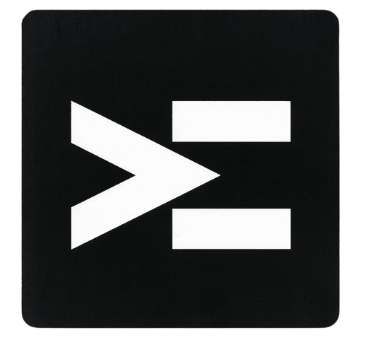
  <h1>TerminalVibe</h1>
  <p><strong>A local-first desktop workspace for terminals, coding agents, and the apps you build.</strong></p>
  <p>
    <a href="https://github.com/Medamine-Bahassou/TerminalVibe/releases">Download</a> ·
    <a href="#features">Features</a> ·
    <a href="#getting-started">Getting started</a> ·
    <a href="https://github.com/Medamine-Bahassou/TerminalVibe/issues">Report a bug or request a feature</a>
  </p>
  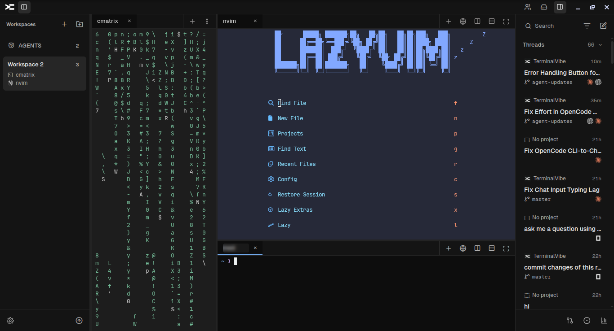
</div>

## Table of contents

- [About the project](#about-the-project)
- [Features](#features)
- [Getting started](#getting-started)
- [Usage](#usage)
- [Keyboard shortcuts](#keyboard-shortcuts)
- [Development](#development)
- [Contributing](#contributing)

## About the project

> This app is built for me as an engineer who wants to use AI agents like Claude Code.
>
> All what you need in T3 Code exists in TerminalVibe, and more.

I wanted to keep an agent conversation, a shell, and the page I'm building in the same window. A project can have its own workspace with a chat, an editor in the terminal, a server log, and a preview. I can switch projects and come back to the layout I left.

**No telemetry in the app.** TerminalVibe is a **local-first app with no cloud backend**. Workspaces, settings, and chat history are stored on your machine. Connected agent CLIs use their own accounts and model providers. Sites you open in browser tabs and GitHub actions use their respective services.

### Built with

Electron and Chromium for the desktop window and browser tabs, node-pty for shell sessions, and xterm.js for terminal rendering. The interface uses JavaScript, HTML, and CSS.

## Features

### Chat with coding agents

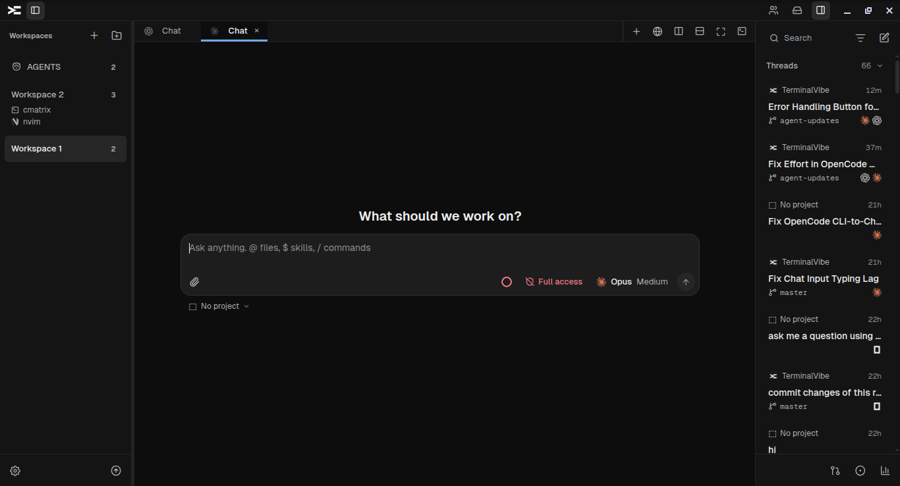

- **Choose the agent for each turn.** Use Claude Code, Codex, Antigravity CLI, or OpenCode with your existing CLI login. The composer lets you pick the model, reasoning effort, and available permission modes. Switch agents in the same thread and TerminalVibe passes along the conversation so far.
- **Follow the work as it happens.** Tool calls and work details expand in place. Supported turns show changed files you can open as diffs. Answer permission requests and agent questions from the chat, stop a run, or queue a follow-up while it works.
- **Pick up a conversation.** The threads sidebar shows active and settled work across projects. Search the current conversation with `Ctrl+F`, fork it from a reply, or use the Claude Code history drawer to find and resume an earlier session.
- **Send project context.** Attach images and files to a prompt. Drag a Claude Code session into a chat to share its context, or drag a workspace into a Claude chat to attach a snapshot of its tabs.
- **Delegate a subtask.** Supported chats can hand a task to Claude Code, Codex, or OpenCode. Open the subagent row to see its progress and continue the conversation in its own thread.
- **Interact with replies.** Agents can send A2UI forms, pickers, buttons, images, and charts directly in chat. A form button can send your selections back to the agent as a follow-up.

See the [chat guide](docs/chat.md) for session handoff, forks, interactive replies, and storage.

### Review changes and manage projects

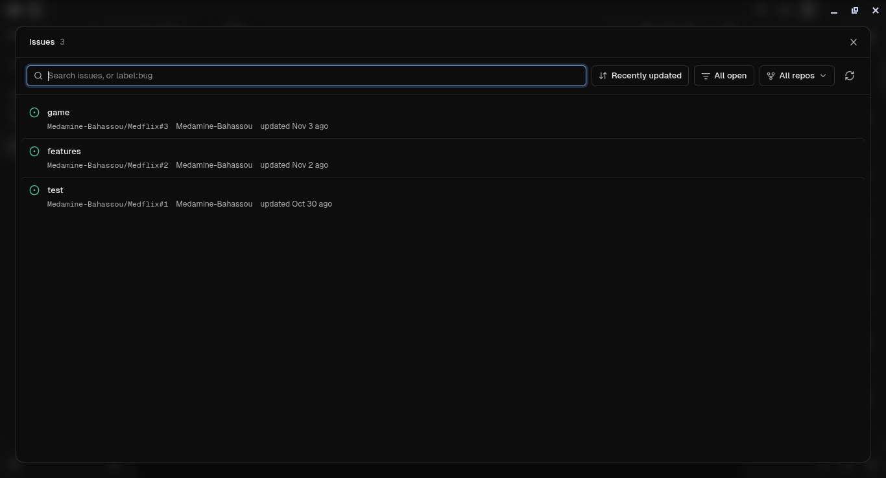

- **Review Git changes beside the conversation.** Thread details shows the project folder, branch, and diff against `origin/main`. Switch branches, commit, push, pull, or create a pull request from the panel.
- **Open issues and pull requests.** Browse GitHub activity for repositories associated with your threads. Search by text or label, filter by state, and sort results.
- **Run a project script.** Launch a command from `package.json` or `t3.json` in a workspace terminal. Open the project in VS Code or choose another installed editor from the same panel.
- **Check agent limits.** The Usage page shows remaining quota and reset times where the agent exposes them. Thread details puts the relevant limits beside your current work.

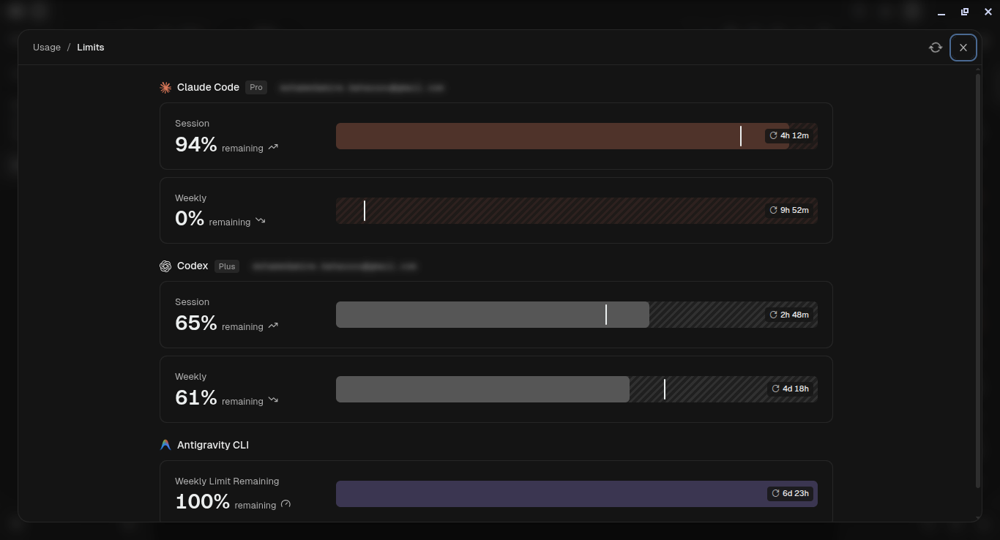

### Arrange workspaces and terminals

- **Give each project a layout.** Name, color, pin, and reorder workspaces. Split panes horizontally or vertically and mix terminals, browser tabs, and chats in the same layout. Drag a tab to another pane or workspace, maximize it when you need the screen, or lock it to prevent accidental input.
- **See what's running.** The sidebar identifies processes in each workspace, including agents launched from a shell. Get a notification with an optional sound when a command or agent finishes in a tab you aren't viewing.
- **Use your existing terminal tools.** Run shells and terminal editors with searchable scrollback, per-tab zoom, clickable links, Unicode, and inline SIXEL and iTerm2 images, including Yazi previews. Bash and Zsh integration tracks the working directory and prompt boundaries. On Windows, use the shell picker to open a WSL tab.
- **Protect personal details on screen.** Settings can blur email addresses and usernames in displayed terminal output. Click a blurred value to reveal it.
- **Jump to what you need.** Open the command palette to find actions, search tabs across workspaces, or open the snippet picker to reuse commands. The bundled [orchestration skill](docs/agent-orchestration.md) lets supported agents open and arrange workspace panes.

| Email blur in a terminal session | Username blur in a shell path |
| --- | --- |
| 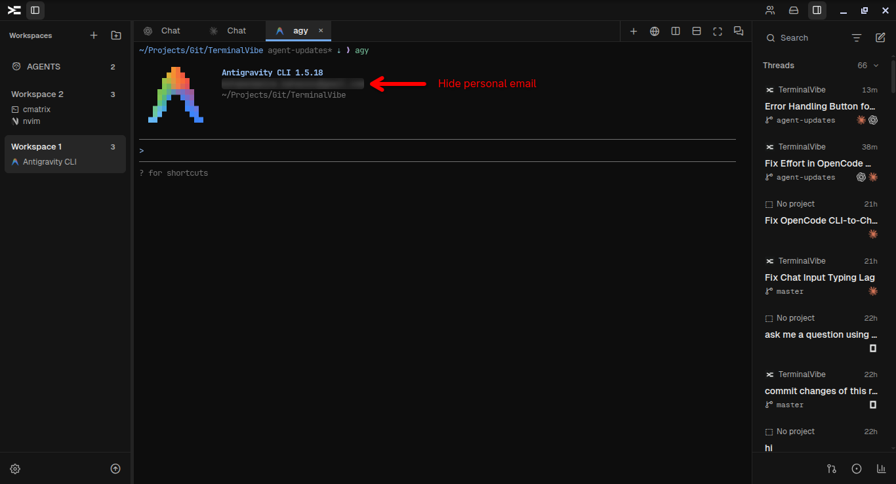 | 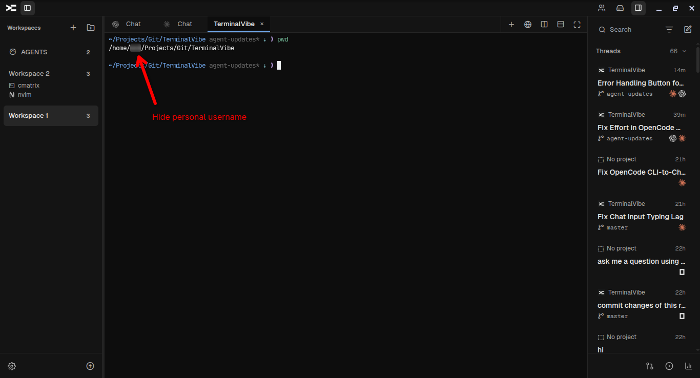 |

### Preview and debug in the built-in browser

- **Keep the preview near the code.** Open a browser tab in any split. Use the address bar to search or navigate, go back or forward, reload the page, or find a site in browser history. Open local PDFs and images in the built-in viewers.
- **Find your dev server.** The running servers menu lists listening ports and their processes. Click a server to open it in a browser tab.
- **Inspect the page.** Press `F12` to open a resizable DevTools drawer beneath the current browser tab. Inspect elements, read the console, and check network requests without leaving the workspace.

| Browser history | Docked DevTools |
| --- | --- |
| 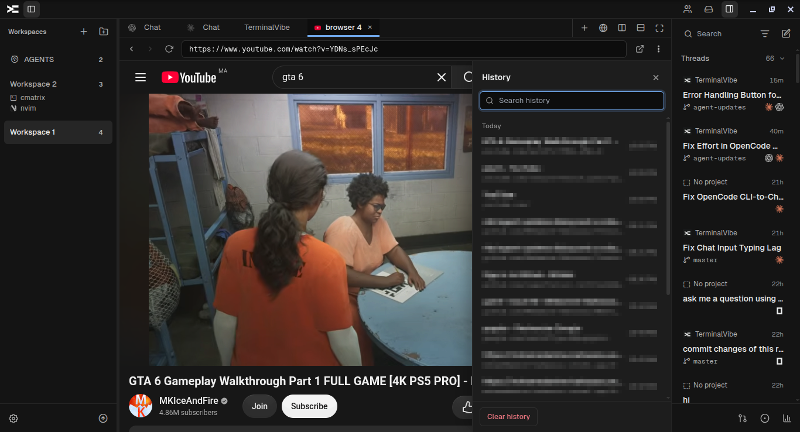 | 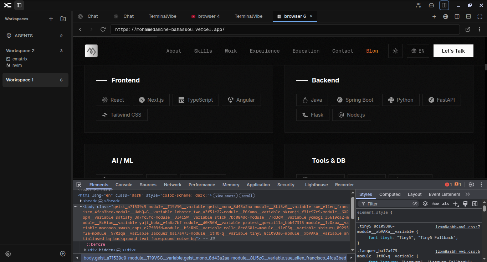 |

### Customize the app and switch profiles

- **Make the terminal yours.** Choose a light, dark, or system color scheme, select a built-in theme, or import a theme or font. Set terminal backgrounds globally, per workspace, or per tab.
- **Set up your workflow.** Pick the default shell, search engine, link behavior, and notification sound. Rebind shortcuts in Settings and see when a key combination conflicts with another action.
- **Keep separate profiles.** Each profile has its own workspaces, chats, and settings. Choose a profile on launch or set a default.

| General settings | Profile picker |
| --- | --- |
| 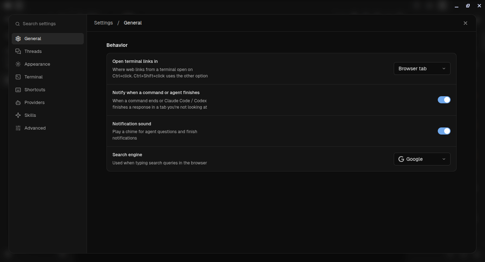 | 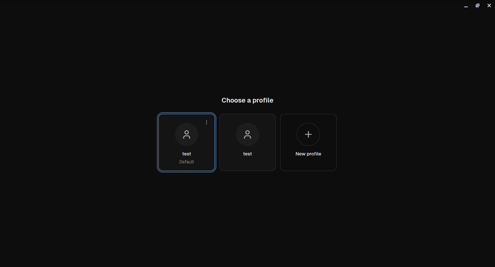 |

[Back to top](#top)

## Getting started

Download the desktop app from [GitHub Releases](https://github.com/Medamine-Bahassou/TerminalVibe/releases).

| Platform | Packages |
| --- | --- |
| Linux | AppImage, `.deb`, `.rpm` |
| Windows | Installer, portable `.exe` |

To use agent chat, install and sign in to the CLI you plan to use. TerminalVibe uses that CLI and its existing credentials. Open **Settings → Providers** to configure your agent.

## Usage

1. Create a workspace for your project and choose its folder.
2. Open a **Chat** tab, select an agent and model, and send a prompt. The threads sidebar lets you return to the conversation from another workspace.
3. Split the workspace and run your dev server in a terminal. Open the detected port from **Servers** to put the preview beside your chat.
4. Open **Thread details** to inspect changes, run project scripts, or open the project in VS Code.

### Command line

Use the `terminalvibe` executable to open a workspace with a predefined layout or focus one you already have.

```bash
terminalvibe new Dev -t "editor:terminal:nvim ." -s v "web:browser:http://localhost:3000"
terminalvibe create -f workspaces.yaml
terminalvibe list
terminalvibe attach Dev
```

See the [CLI guide](docs/cli.md) for tab specifications, profiles, and YAML layouts.

## Keyboard shortcuts

Change these defaults in **Settings → Shortcuts**.

| Action | Default |
| --- | --- |
| New terminal / close tab | `Ctrl+Shift+T` / `Ctrl+Shift+W` |
| New browser tab | `Ctrl+Shift+B` |
| Split horizontally / vertically | `Ctrl+Shift+D` / `Ctrl+Shift+E` |
| Command palette / tab search | `Ctrl+Shift+K` / `Ctrl+Shift+O` |
| Snippets | `Ctrl+Shift+Y` |
| Find in terminal / chat | `Ctrl+Shift+F` / `Ctrl+F` |
| Focus pane left / down / up / right | `Alt+H` / `Alt+J` / `Alt+K` / `Alt+L` |
| Jump to workspace 1 through 9 | `Alt+1` through `Alt+9` |
| Maximize or restore tab | `Ctrl+Shift+M` |
| Browser DevTools | `F12` |
| Profiles / toggle sidebar | `Ctrl+Shift+P` / `Ctrl+Shift+S` |

## Development

Use Git, npm, and Node.js 22, which matches the release workflow. On Debian or Ubuntu, install `build-essential` and `python3` if `node-pty` needs to compile from source.

```bash
git clone https://github.com/Medamine-Bahassou/TerminalVibe.git
cd TerminalVibe
npm ci
npm run electron:dev
```

| Command | Use |
| --- | --- |
| `npm start` | Run the browser development mode at `http://localhost:6969` |
| `npm test` | Run the core suite |
| `npm run test:chat` | Run chat-specific checks |
| `npm run test:browser` | Check browser pane resizing and snapshots |
| `npm run build:linux` | Package AppImage, Debian, and RPM builds in `release/` |
| `npm run build:win` | Package the Windows installer and portable executable in `release/` |

For the desktop app internals and contribution workflow, see the [architecture notes](ARCHITECTURE.md) and the [feature development guide](docs/adding-a-feature.md).

## Contributing

Open a [GitHub issue](https://github.com/Medamine-Bahassou/TerminalVibe/issues) with steps to reproduce a bug or a description of the workflow you'd like to improve. For a pull request, run `npm test` and `node scripts/build-dist.js` before submitting.

[Back to top](#top)
