<p align="center">
  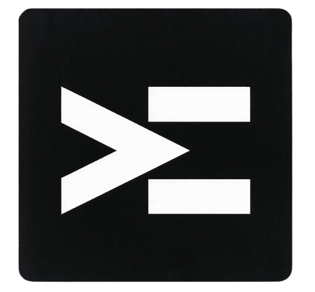
</p>

<h1 align="center">TerminalVibe</h1>

<p align="center">
  A terminal multiplexer for the AI-agent era.<br>
  Workspaces, split panes, tab groups and real browser tabs in one quiet, keyboard-first desktop app.
</p>

<p align="center">
  <a href="https://github.com/Medamine-Bahassou/TerminalVibe/releases">Download</a> ·
  <a href="#features">Features</a> ·
  <a href="#keyboard-shortcuts">Shortcuts</a> ·
  <a href="#development">Development</a> ·
  <a href="ARCHITECTURE.md">Architecture</a>
</p>

<p align="center">
  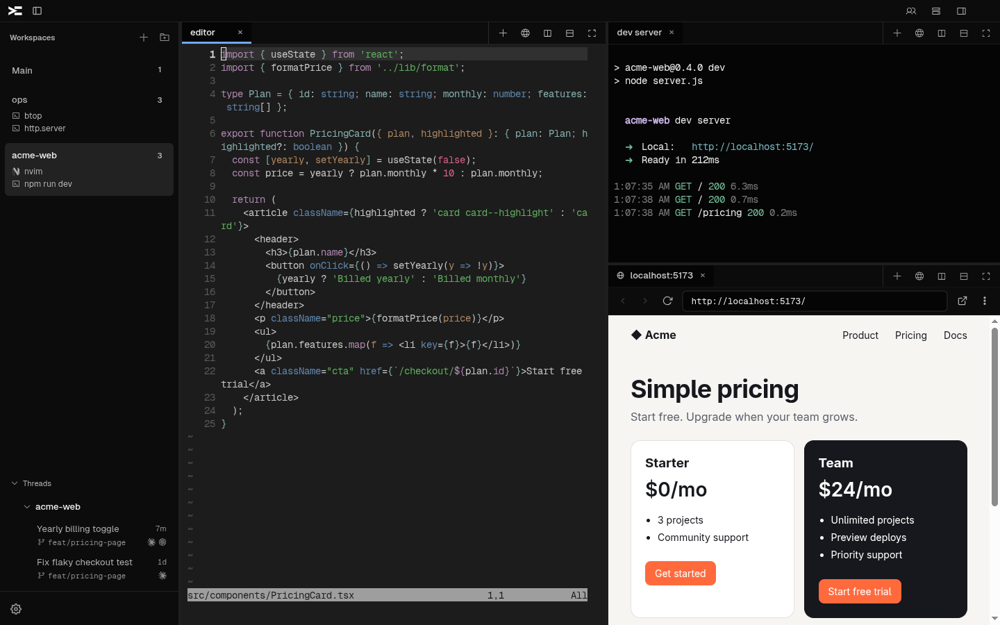
</p>

## Why TerminalVibe

Your editor, dev server, logs, coding agents and the page you're building all live
in one window. Each project gets its own **workspace** with its own split layout.
The sidebar shows what is running in each workspace, so you can see which ones are
busy without opening them.

## Features

### Workspaces and layout
- **Workspaces** with names, icons, colors and folders. Drag to reorder and pin the ones you use most. Your last workspace is restored on launch.
- **Recursive split panes**, horizontal and vertical. Drag tabs between panes, or onto the sidebar to move them to another workspace.
- **Tab groups** in every pane. Each group holds any mix of terminals and browser tabs.
- **Maximize** any tab (`Ctrl+Shift+M`), **lock** a tab to block accidental typing, or **detach** a tab into its own window.
- **Live process list** for every workspace in the sidebar, with brand icons for `nvim`, `node`, `python`, `claude`, `codex` and more.
- **Auto-run workspaces**: save a layout once, then launch it again with every tab running its command or opening its URL.
- **Profiles**: fully isolated sets of workspaces and settings with a launch picker and a default profile (`Ctrl+Shift+P`).

### Built-in browser
- **Browser tabs next to your terminals**, with back/forward, reload, URL bar search and browsing history.
- **Running servers** menu in the titlebar lists every listening port with its process. Click one to open it in a tab.
- Opens local files, **PDFs** and **images** in the browser's native viewers.
- Terminal links can open in a browser tab or in your system browser (your choice in Settings).

### Built for coding agents
- **Claude Code session history**: a drawer in any Claude tab that lists past conversations across projects. Search them, resume one in place, open one in a new tab, or drag one into a chat to attach its context.
- **Workspace context**: drag a workspace onto a Claude chat to attach a snapshot of all its tabs.
- **Agent orchestration skill**: install it for Claude Code or Codex from **Settings → Skills**. Your agent can then open other agents in named splits, arrange panes, read their output, send follow-up input, and drive browser panes through an authenticated local control channel. See [docs/agent-orchestration.md](docs/agent-orchestration.md).
- **Command-finished notifications** when a long task ends while the app is in the background.

### Terminal
- xterm.js with the WebGL renderer, Unicode 11 and clickable links.
- **Inline images**: SIXEL and iTerm2 protocols, including Yazi previews.
- **Shell integration** for bash and zsh: the working directory (OSC 7) and prompt markers are tracked and persisted.
- Incremental search (`Ctrl+Shift+F`), per-terminal font zoom (`Ctrl+Scroll`), multi-select (`Ctrl+Alt+Click`), clipboard history and pasting images.
- **Directional pane focus** with `Alt+H/J/K/L`.

### Command palette and snippets
- **Command palette** (`Ctrl+Shift+K`): every action in one searchable list.
- **Tab search** (`Ctrl+Shift+O`): jump to any tab in any workspace.
- **Snippets** (`Ctrl+Shift+Y`) and **history**, in the same palette.

### Look and feel
- Calm dark UI with Geist Sans and Geist Mono, and dark, light or system color schemes.
- **9 built-in themes**: Carbon, Graphite, Catppuccin Mocha, Dracula, Gruvbox, Tokyo Night, Nord, Solarized Dark and Monochrome. Import custom themes as JSON.
- Terminal **background images**, global or per tab, with adjustable opacity.
- **Every shortcut can be rebound** in Settings, with conflict detection and per-shortcut reset.

### Extensible
- **Plugins**: drop a folder into `~/.terminalvibe/plugins/` to add commands, keybindings, terminal hooks, context-menu items, themes, settings sections and widgets. See [docs/plugin-development.md](docs/plugin-development.md).
- **CLI**: `terminalvibe new | create -f layout.yaml | list | close | attach` builds workspaces from the command line or from YAML. See [docs/cli.md](docs/cli.md).

## Screenshots

### Agents side by side
Claude Code and Codex in named splits. The sidebar groups the processes running in each workspace.

<p align="center">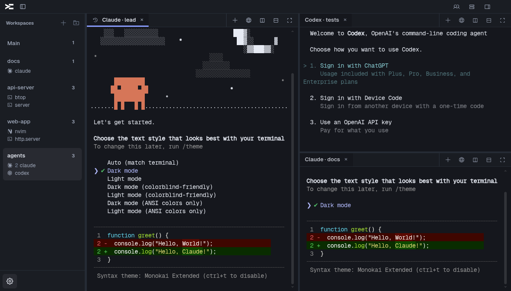</p>

### Claude Code session history
Browse, search, resume or drag in past conversations without leaving the pane.

<p align="center">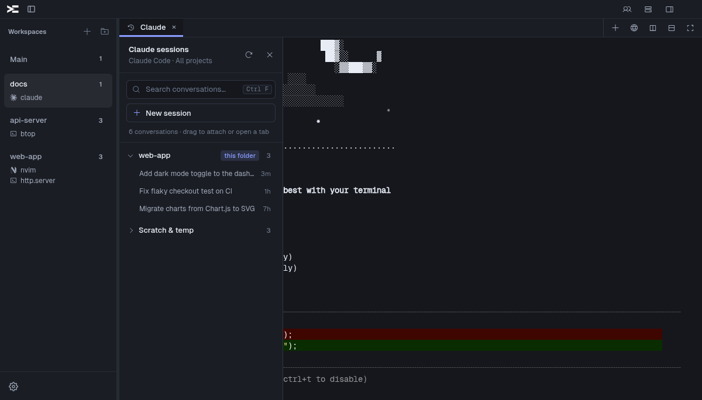</p>

### Running servers
Every listening port at a glance. Click one to open it in a browser tab.

<p align="center">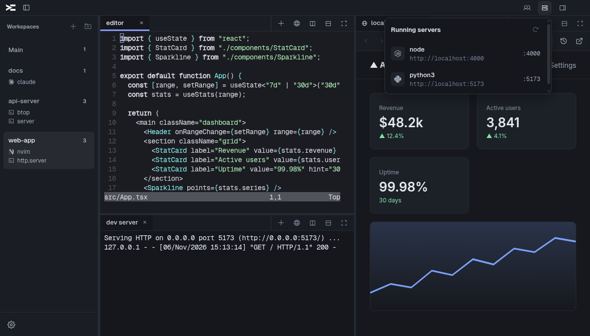</p>

### Monitoring layouts
Build any layout from splits. Here: `btop`, an API server and a git log.

<p align="center">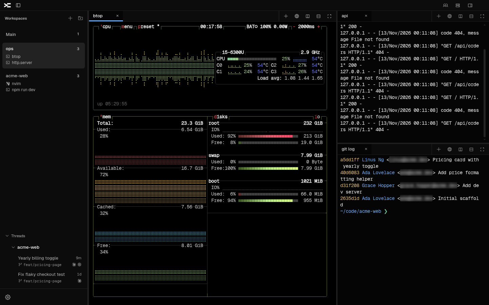</p>

### Command palette and tab search

<p align="center">
  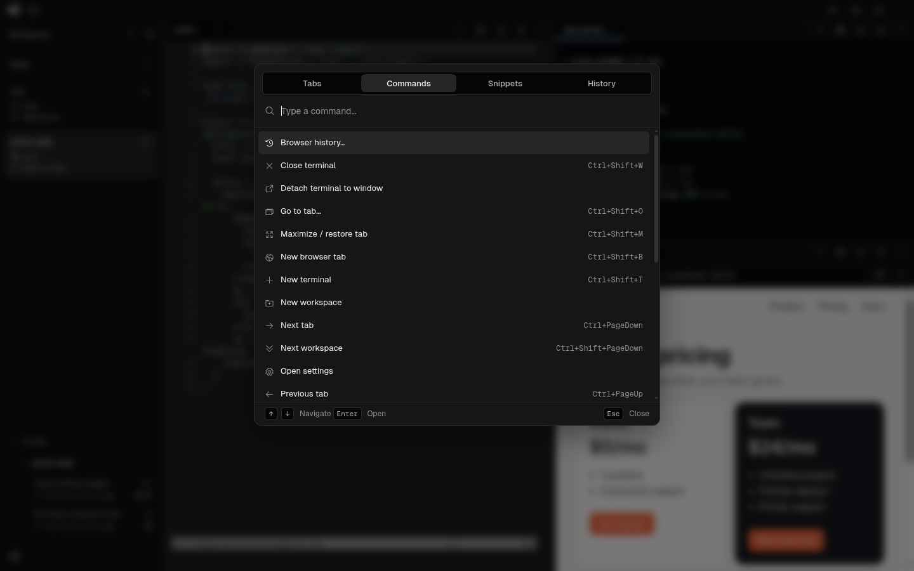
  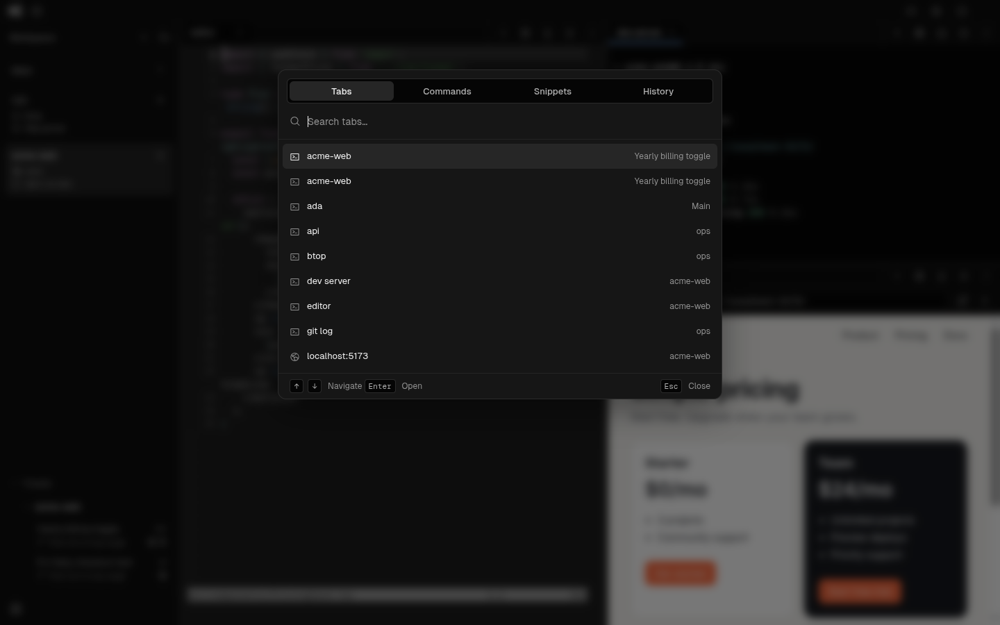
</p>

### Themes and shortcuts

<p align="center">
  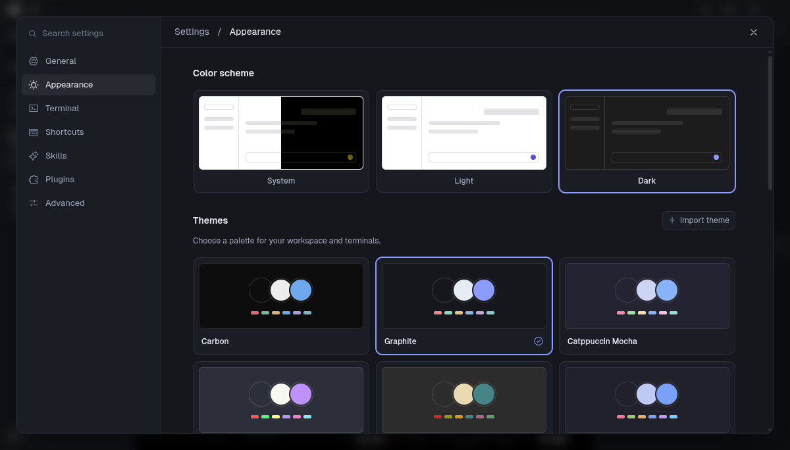
  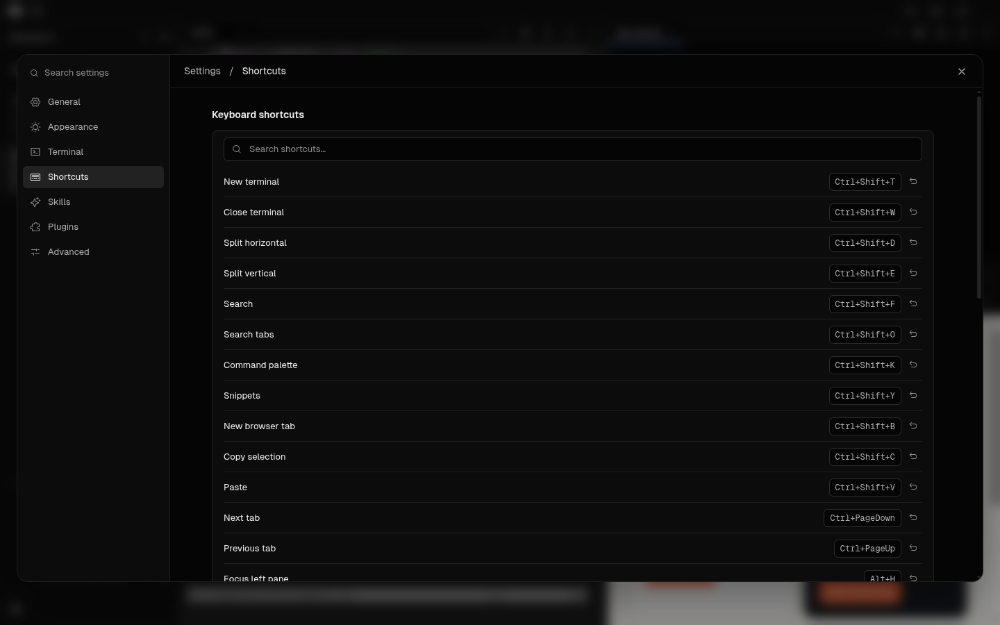
</p>

### Profiles and skills

<p align="center">
  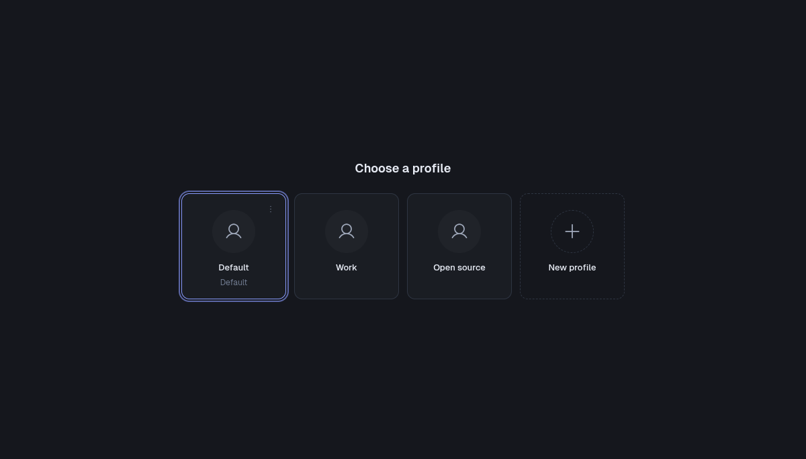
  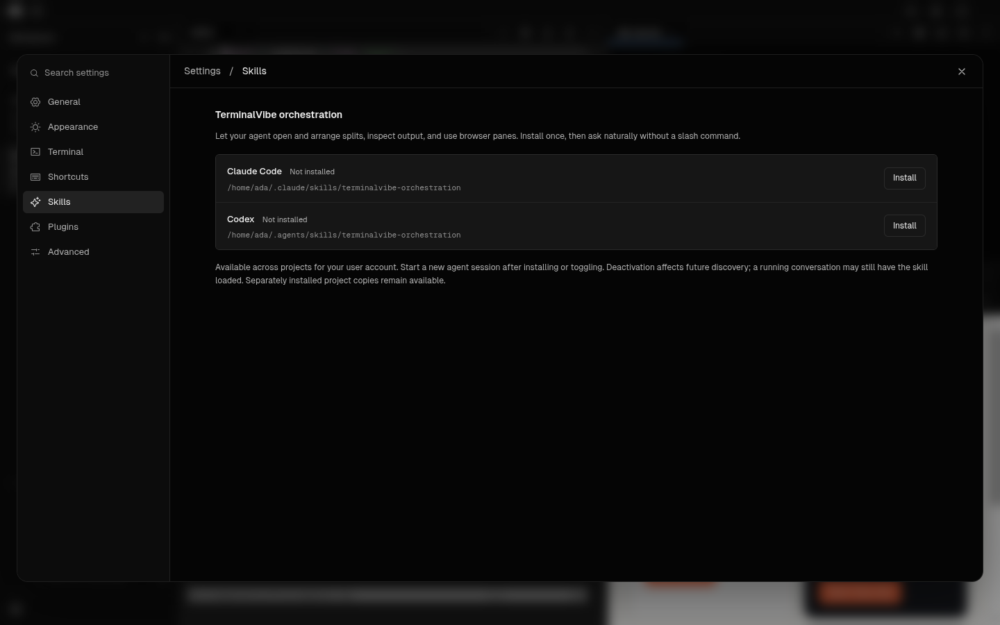
</p>

## Keyboard shortcuts

These are the defaults. Rebind any of them in **Settings → Shortcuts**.

| Action | Shortcut |
|---|---|
| New terminal / close tab | `Ctrl+Shift+T` / `Ctrl+Shift+W` |
| New browser tab | `Ctrl+Shift+B` |
| Split horizontal / vertical | `Ctrl+Shift+D` / `Ctrl+Shift+E` |
| Command palette | `Ctrl+Shift+K` |
| Search tabs | `Ctrl+Shift+O` |
| Snippets | `Ctrl+Shift+Y` |
| Search in terminal | `Ctrl+Shift+F` |
| Copy / paste | `Ctrl+Shift+C` / `Ctrl+Shift+V` |
| Next / previous tab | `Ctrl+PageDown` / `Ctrl+PageUp` |
| Next / previous workspace | `Ctrl+Shift+PageDown` / `Ctrl+Shift+PageUp` |
| Jump to workspace 1–9 | `Alt+1` … `Alt+9` |
| Focus pane left / down / up / right | `Alt+H` / `Alt+J` / `Alt+K` / `Alt+L` |
| Maximize / restore tab | `Ctrl+Shift+M` |
| Multi-select terminals | `Ctrl+Alt+Click` |
| Profiles | `Ctrl+Shift+P` |
| Toggle sidebar | `Ctrl+Shift+S` |
| Quit | `Ctrl+Shift+Q` |

## Install

Grab an **AppImage**, **.deb** or **.rpm** from the
[releases page](https://github.com/Medamine-Bahassou/TerminalVibe/releases).
Every push to `master` builds a new release.

## Development

**Requirements:** Node.js 18+ and npm. `node-pty` compiles native code when no prebuilt
binary is available. On Ubuntu/Debian (including WSL), install the build tools first:

```bash
sudo apt-get install -y build-essential python3
```

On WSL, Electron needs WSLg for GUI support.

```bash
npm install              # also generates vendor/ assets
npm run electron:dev     # desktop app (main-process changes need a full restart)
npm start                # browser mode: node server.js → http://localhost:6969
```

Run one mode at a time, since both use the dev static server on port 7769.

After editing frontend files, copy them into `dist/`:

```bash
node scripts/build-dist.js
```

### Tests

```bash
npm test                 # CLI, skills, agent control, servers, shell startup, sessions
npm run test:browser     # browser-pane resize + snapshot
npm run test:sessions    # Claude session history drawer
npm run test:images      # SIXEL / iTerm2 image rendering
npm run test:images:yazi # same, plus a real Yazi in an isolated PTY
node --check app.js      # quick syntax check
```

### Build packages

```bash
npm run build            # unpacked Linux build in release/
npm run build:linux      # AppImage + deb + rpm
npm run build:win        # NSIS installer + portable
```

Run `build:win` from a checkout on a Windows drive, with Windows Node. It uses node-pty's
prebuilt binaries, so Visual Studio isn't needed. It can't run from a `\\wsl.localhost` path,
and running it inside Linux or WSL needs `wine`.

## Project layout

| Path | Role |
|---|---|
| `index.html` | Static markup: titlebar, sidebar, modals, settings |
| `app.js` | All renderer logic (one IIFE): state, layout, terminals, browser tabs, settings |
| `session-drawer.js` | Claude Code session history drawer |
| `workspace.css` | Design system and component styles (`style.css` holds the base layout) |
| `electron/main.js` · `preload.js` | Main process: PTYs, IPC, native menus, windows, browser views |
| `electron/agent-control.js` | Authenticated local control channel used by the orchestration skill |
| `server.js` | Browser-mode backend (WebSocket PTY server, proxy) |
| `skills/terminalvibe-orchestration/` | Agent skill and the `tv.js` client |
| `examples/` | Example plugins |
| `docs/` | CLI, plugins, agent orchestration, feature recipes |

Read [ARCHITECTURE.md](ARCHITECTURE.md) for the full architecture and
[docs/adding-a-feature.md](docs/adding-a-feature.md) for recipes.

## Tech stack

Electron · node-pty · xterm.js 5 (WebGL, image, search, unicode11, web-links addons) ·
vanilla JS with no framework or bundler · Phosphor icons · Geist fonts.
