<div align="center">


# TerminalVibe

**The terminal workspace for the AI-agent era.**

Workspaces, split panes, agent chats and real browser tabs in one quiet, keyboard-first desktop app.

[](https://github.com/Medamine-Bahassou/TerminalVibe/releases)
[](https://github.com/Medamine-Bahassou/TerminalVibe/releases)
[](https://github.com/Medamine-Bahassou/TerminalVibe/stargazers)


[**Download**](https://github.com/Medamine-Bahassou/TerminalVibe/releases) ·
[Features](#features) ·
[Shortcuts](#keyboard-shortcuts) ·
[Development](#development) ·
[Architecture](ARCHITECTURE.md)

<br>

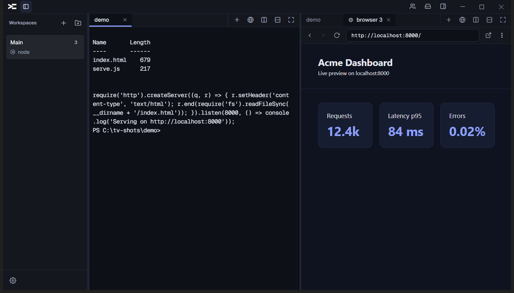

</div>

---

## Why TerminalVibe?

Your editor, dev server, logs, coding agents and the page you're building all live in **one window**.

<table>
  <tr>
    <td width="33%" valign="top">
      <h3>Workspaces</h3>
      Each project gets its own workspace with its own split layout. The sidebar shows what is running everywhere.
    </td>
    <td width="33%" valign="top">
      <h3>Agent-native</h3>
      Chat with Claude Code, Codex, Gemini, Antigravity or OpenCode. Switch agents mid-thread and delegate subagents across them.
    </td>
    <td width="33%" valign="top">
      <h3>Browser inside</h3>
      Real browser tabs with DevTools sit next to your terminals, one click away from every running server.
    </td>
  </tr>
</table>

## Features

<details open>
<summary><b>Contents</b></summary>

- [Threads and agent chats](#threads-and-agent-chats)
- [Built for coding agents](#built-for-coding-agents)
- [Workspaces and layout](#workspaces-and-layout)
- [Built-in browser](#built-in-browser)
- [Terminal](#terminal)
- [Command palette, tab search and snippets](#command-palette-tab-search-and-snippets)
- [Look and feel](#look-and-feel)
- [Profiles](#profiles)
- [CLI](#cli)

</details>

### Threads and agent chats

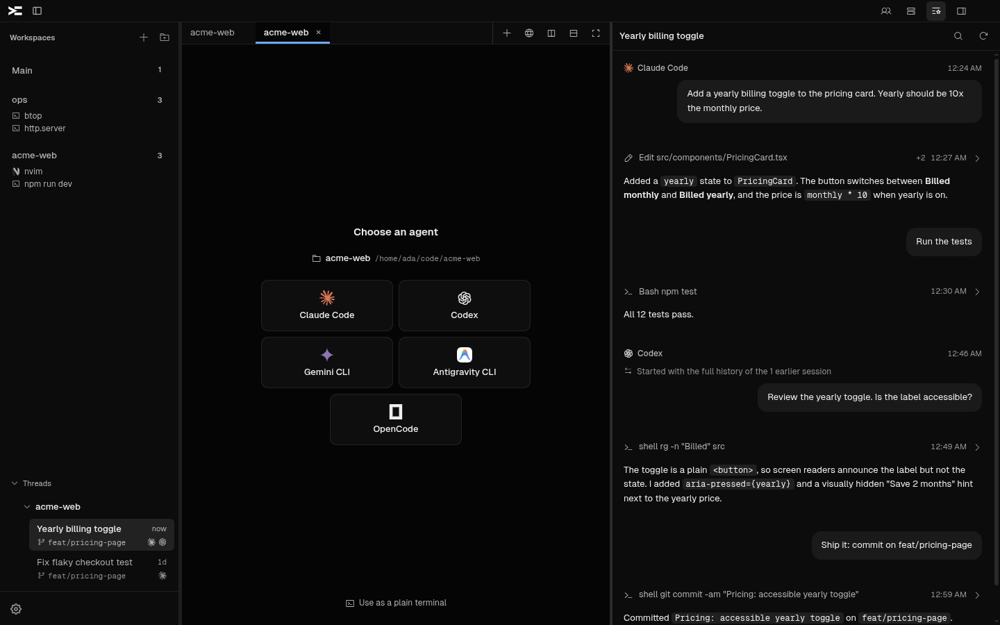

- **One thread, many agents.** Start a thread with **Claude Code**, **Codex**, **Gemini CLI**, **Antigravity CLI** or **OpenCode**, then switch agents mid-conversation. The new agent gets the earlier history.
- **Model picker** for each turn: agent, model and reasoning effort, plus permission modes (Ask first, Auto, Accept edits, Plan only, Full access).
- **Subagents on any harness.** Every chat gets a `delegate_task` tool, so you can ask Claude Code for "a codex subagent", or the other way around.
- **Full history**: prompts, replies, expandable tool calls and pasted images. Search with `Ctrl+F` and copy any message. TerminalVibe keeps its own copy, so a chat survives deleted transcripts.
- **Queue and schedule** messages to send while the agent is busy, or later.
- **Thread details**: branch switcher, commit, push and PR actions, a diff against `origin/main`, project scripts, running servers, and **Session/Weekly usage limits**.
- **Issues and Pull requests pages** for the GitHub repos your threads use, with search, `label:` filters, sorting and state filters.
- Agents you start by hand in a terminal (`claude`, `codex`, …) are picked up automatically.

See [docs/chat.md](docs/chat.md) for details.

### Built for coding agents

- **Claude Code session history**: a drawer that lists past conversations across projects. Search one, resume it in place, open it in a new tab, or drag it into a chat to attach its context.
- **Workspace context**: drag a workspace onto a Claude chat to attach a snapshot of all its tabs.
- **Image previews on hover**: hover an `[Image #N]` or `[Pasted text #N]` chip to see what it holds. `Ctrl+click` opens a viewer with zoom, pan and rotate.
- **Orchestration skill**: your agent can open other agents in named splits, arrange panes, read their output, send them input and drive browser panes over an authenticated local channel. See [docs/agent-orchestration.md](docs/agent-orchestration.md).
- **Finish notifications**, with an optional chime, when a command or agent finishes in a tab you aren't looking at.

<p align="center">
  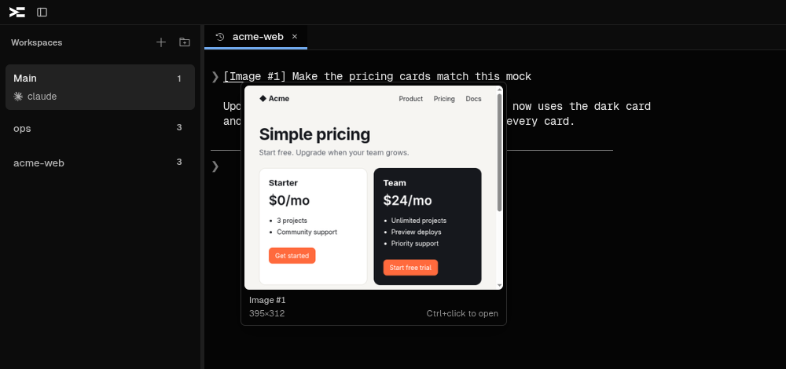
</p>
<p align="center">
  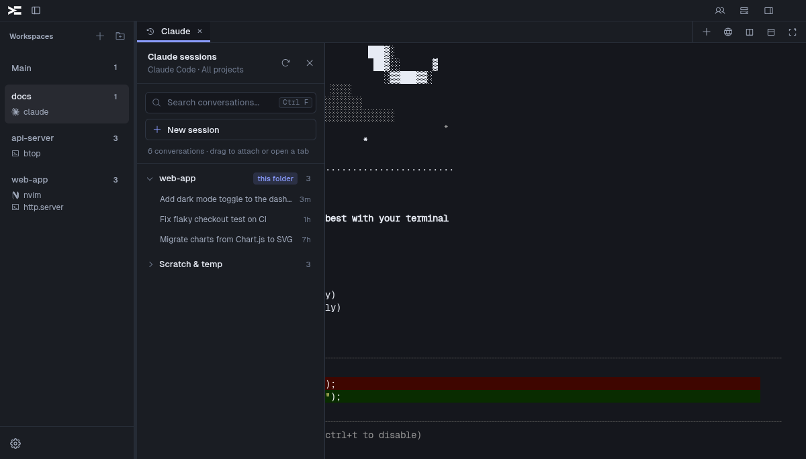
  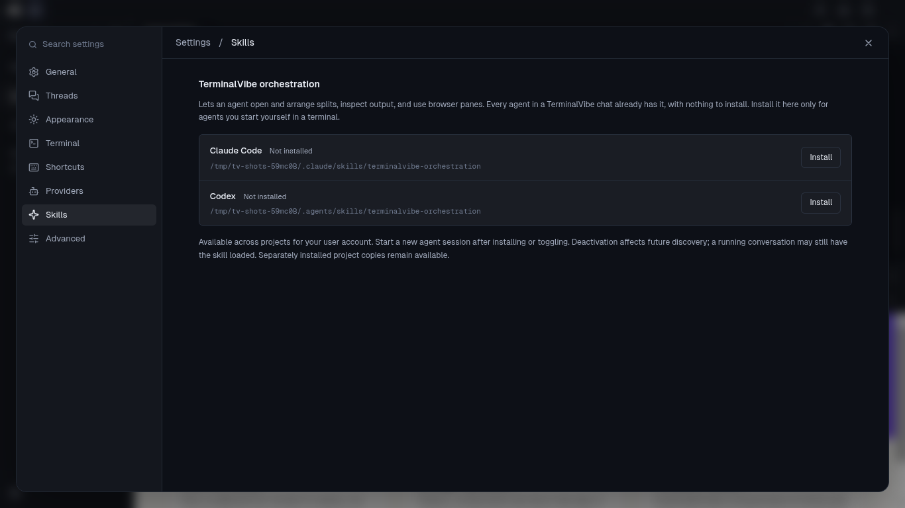
</p>

### Workspaces and layout

- **Workspaces** with names, icons, colors and folders. Drag to reorder, pin favorites, and jump with `Alt+1` … `Alt+9`. Your last workspace opens on launch.
- **Recursive split panes**, horizontal and vertical. Drag tabs between panes, or onto the sidebar to move them to another workspace.
- **Tab groups** in every pane, holding any mix of terminals, browser tabs and chats.
- **Maximize** a tab (`Ctrl+Shift+M`) or **lock** it to block accidental typing.
- **Live process list** for each workspace, with brand icons for `nvim`, `node`, `python`, `claude`, `codex` and more.
- **Sidebar modes**: always visible, expand on hover, or hidden (`Ctrl+Shift+S`).

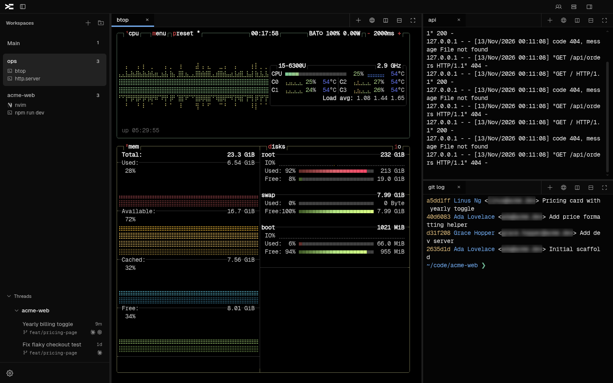

### Built-in browser

- **Browser tabs next to your terminals**, with back/forward, reload, URL bar search and history.
- **DevTools drawer** (`F12`) docked under the page, resizable, per tab.
- **Running servers** menu lists every listening port with its process. Click one to open it.
- Opens local files, **PDFs** and **images** in the native viewers.
- `Ctrl+click` a terminal link to open it in a browser tab or your system browser. `Ctrl+Shift+click` uses the other one.

<p align="center">
  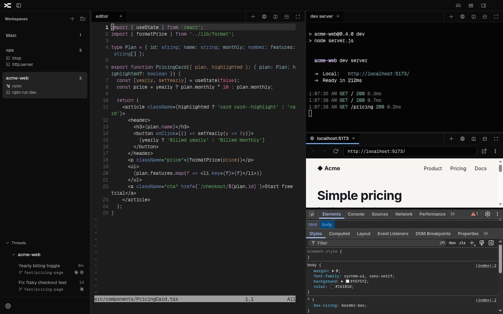
  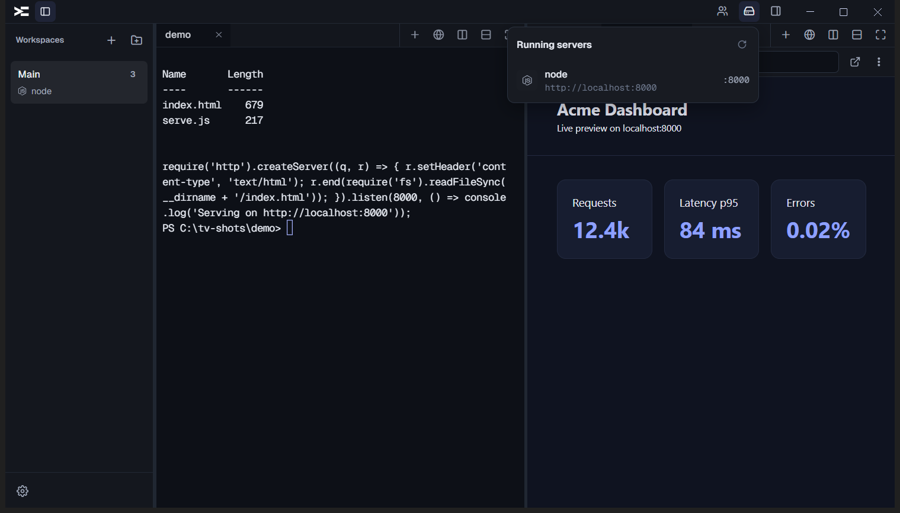
</p>

### Terminal

- xterm.js with the **WebGL renderer**, Unicode 11 and clickable links.
- **Inline images**: SIXEL and iTerm2 protocols, including Yazi previews.
- **Email blur**: addresses in terminal output stay blurred until you click one.
- **Drop files or text** into a terminal to paste their paths or contents.
- **Shell integration** for bash and zsh: the working directory (OSC 7) and prompt markers are tracked and restored.
- A **default shell** setting, plus a shell picker on the new-tab button (right-click). WSL tabs keep their folder.
- Incremental search (`Ctrl+Shift+F`), per-terminal zoom (`Ctrl+Scroll`), multi-select (`Ctrl+Alt+Click`), directional focus (`Alt+H/J/K/L`).
- **Flow control** pauses programs that flood output until the terminal catches up, so the UI never freezes.

<p align="center">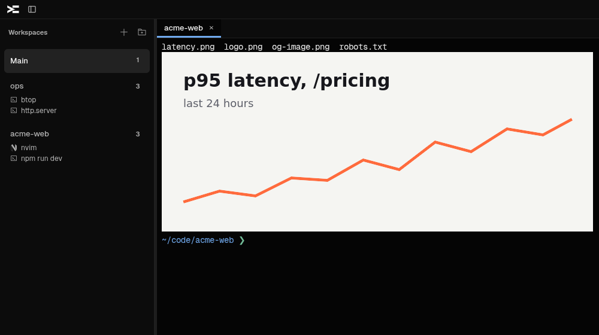</p>

### Command palette, tab search and snippets

- **Command palette** (`Ctrl+Shift+K`) lists every action and workspace, with their shortcuts.
- **Tab search** (`Ctrl+Shift+O`) jumps to any tab in any workspace.
- **Snippets** (`Ctrl+Shift+Y`) and **browser history** live in the same palette.

<p align="center">
  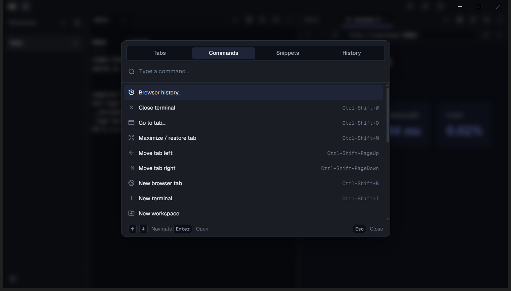
  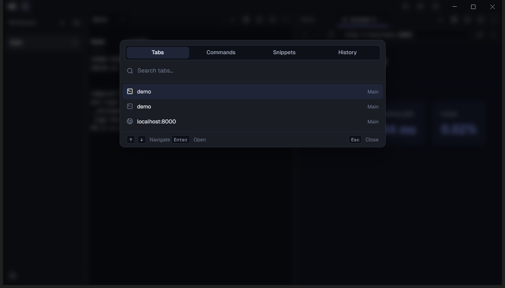
</p>

### Look and feel

- A calm dark UI set in Geist Sans and Geist Mono, with dark, light or system color schemes.
- **9 built-in themes**: Carbon, Graphite, Catppuccin Mocha, Dracula, Gruvbox, Tokyo Night, Nord, Solarized Dark and Monochrome. Import your own themes and fonts.
- Terminal **background images**, set globally, per workspace or per tab, with adjustable opacity.
- **Every shortcut can be rebound**, with conflict detection and a reset for each one.
- **Offline by design**: fonts, icons and styles ship with the app, so it makes no network requests at launch.

<p align="center">
  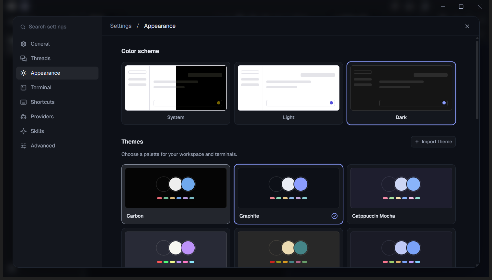
  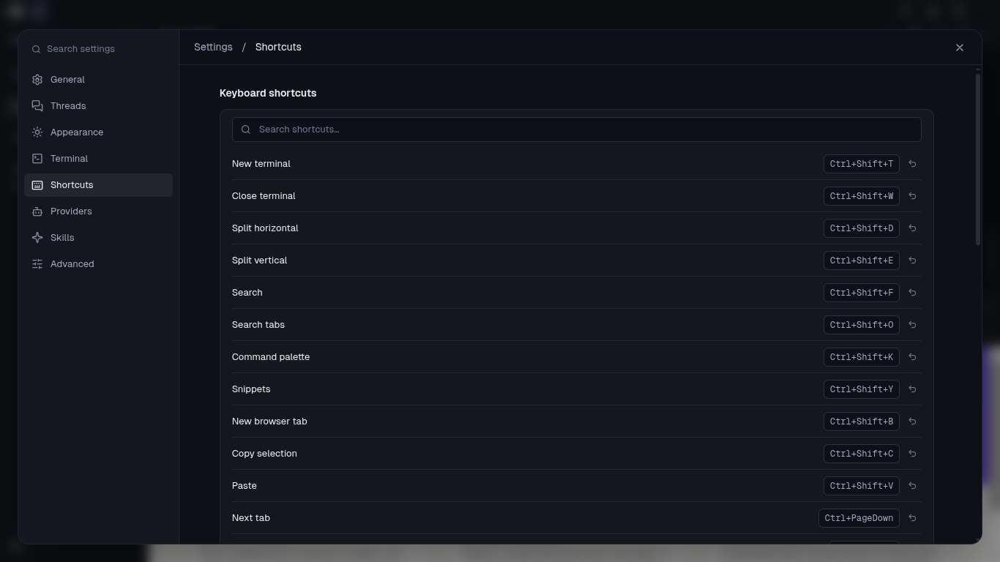
</p>

### Profiles

Each profile is a fully isolated set of workspaces, chats and settings. Pick one at launch or set a default (`Ctrl+Shift+P`).

<p align="center">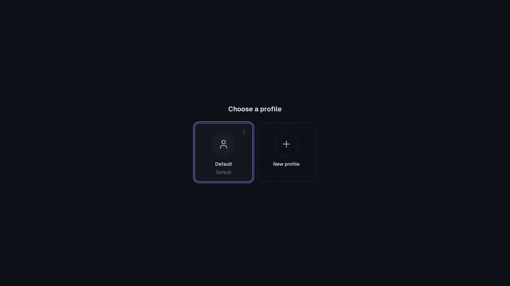</p>

### CLI

Build workspaces from the command line or from YAML:

```bash
terminalvibe new                     # open a new workspace
terminalvibe create -f layout.yaml   # build splits and tabs from a layout file
terminalvibe list | close | attach
```

See [docs/cli.md](docs/cli.md).

## Install

| Platform | Package |
|---|---|
| **Linux** | AppImage · `.deb` · `.rpm` |
| **Windows** | Installer · portable `.exe` |

Download the latest build from the [**releases page**](https://github.com/Medamine-Bahassou/TerminalVibe/releases). Every push to `master` publishes a new release.

## Keyboard shortcuts

These are the defaults. You can rebind any of them in **Settings → Shortcuts**.

<details>
<summary><b>Show all shortcuts</b></summary>

| Action | Shortcut |
|---|---|
| New terminal / close tab | `Ctrl+Shift+T` / `Ctrl+Shift+W` |
| New browser tab | `Ctrl+Shift+B` |
| Split horizontal / vertical | `Ctrl+Shift+D` / `Ctrl+Shift+E` |
| Command palette | `Ctrl+Shift+K` |
| Search tabs | `Ctrl+Shift+O` |
| Snippets | `Ctrl+Shift+Y` |
| Search in terminal (or in the chat history) | `Ctrl+Shift+F` (`Ctrl+F` in a Chat tab) |
| Copy / paste | `Ctrl+Shift+C` / `Ctrl+Shift+V` |
| Next / previous tab | `Ctrl+PageDown` / `Ctrl+PageUp` |
| Move tab right / left | `Ctrl+Shift+PageDown` / `Ctrl+Shift+PageUp` |
| Next / previous workspace | `Ctrl+Alt+PageDown` / `Ctrl+Alt+PageUp` |
| Jump to workspace 1–9 | `Alt+1` … `Alt+9` |
| Focus pane left / down / up / right | `Alt+H` / `Alt+J` / `Alt+K` / `Alt+L` |
| Maximize / restore tab | `Ctrl+Shift+M` |
| Multi-select terminals | `Ctrl+Alt+Click` |
| Browser DevTools | `F12` |
| Profiles | `Ctrl+Shift+P` |
| Toggle sidebar | `Ctrl+Shift+S` |
| Quit | `Ctrl+Shift+Q` |

</details>

## Development

**Requirements:** Node.js 18+ and npm. `node-pty` compiles native code when no prebuilt binary is available. On Ubuntu/Debian (including WSL), install the build tools first with `sudo apt-get install -y build-essential python3`. On WSL, Electron needs WSLg.

```bash
git clone https://github.com/Medamine-Bahassou/TerminalVibe.git
cd TerminalVibe
npm install              # also generates vendor/ assets
npm run electron:dev     # desktop app (main-process changes need a full restart)
npm start                # or browser mode: node server.js → http://localhost:6969
```

Run one mode at a time, since both use the dev static server on port 7769. After editing frontend files, run `node scripts/build-dist.js`.

<details>
<summary><b>Tests</b></summary>

```bash
npm test                 # CLI, skills, agent control, servers, shell startup, sessions, chat history
npm run test:browser     # browser-pane resize + snapshot
npm run test:sessions    # Claude session history drawer
npm run test:images      # SIXEL / iTerm2 image rendering
npm run test:images:yazi # same, plus a real Yazi in an isolated PTY
node --check app.js      # quick syntax check
```

</details>

<details>
<summary><b>Build packages</b></summary>

```bash
npm run build            # unpacked Linux build in release/
npm run build:linux      # AppImage + deb + rpm
npm run build:win        # NSIS installer + portable
```

Run `build:win` from a checkout on a Windows drive, with Windows Node. It uses node-pty's prebuilt binaries, so you don't need Visual Studio. It can't run from a `\\wsl.localhost` path, and running it on Linux or WSL needs `wine`.

</details>

<details>
<summary><b>Project layout</b></summary>

| Path | Role |
|---|---|
| `index.html` | Static markup: titlebar, sidebar, modals, settings |
| `app.js` | All renderer logic (one IIFE): state, layout, terminals, browser tabs, chat tabs, settings |
| `proc-icons.js` | Brand logos for running processes and agents |
| `workspace.css` | Design system and component styles (`style.css` holds the base layout) |
| `electron/main.js` · `preload.js` | Main process: PTYs, IPC, native menus, windows, browser views |
| `electron/threads.js` | Chat history: reads agent transcripts and keeps a copy |
| `electron/delegate-mcp.js` | `delegate_task` MCP server for cross-harness subagents |
| `electron/agent-control.js` | Authenticated local control channel used by the orchestration skill |
| `server.js` | Browser-mode backend (WebSocket PTY server, proxy) |
| `skills/terminalvibe-orchestration/` | Agent skill and the `tv.js` client |
| `docs/` | Chat tabs, CLI, agent orchestration, feature recipes |

Read [ARCHITECTURE.md](ARCHITECTURE.md) for the full architecture and [docs/adding-a-feature.md](docs/adding-a-feature.md) for recipes.

</details>

### Tech stack

Electron · node-pty · xterm.js 5 (WebGL, image, search, unicode11, web-links) · vanilla JS, no framework or bundler · Lucide icons · Geist fonts

## Contributing

Issues and pull requests are welcome. Before you open a PR, run `npm test` and `node scripts/build-dist.js`. For larger changes, open an issue first so we can agree on the approach.

## Star history

<a href="https://star-history.com/#Medamine-Bahassou/TerminalVibe&Date">
  
</a>

---

<div align="center">
<sub>If TerminalVibe makes your day calmer, consider giving it a ⭐</sub>
</div>
